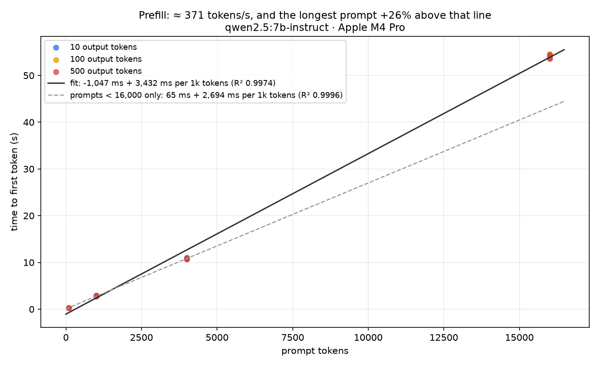
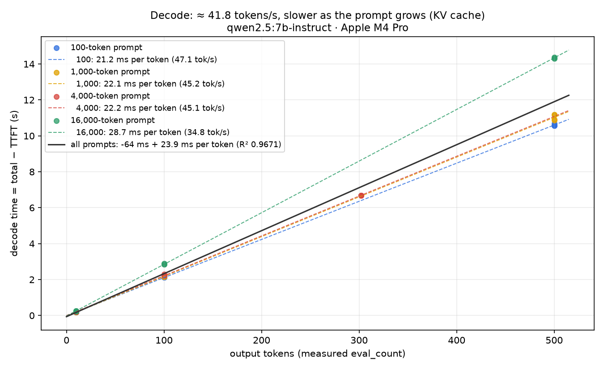

# Day 2: Why the first word is slow

The code from the Day 2 video. Every request to an AI model is two jobs: **reading** your
prompt (prefill) and **writing** the answer one token at a time (decode). This drill times
both on your own laptop and fits a straight line to each, so you end with two numbers:
how fast your machine reads, and how fast it writes.

Lesson: [docs/days/day-002-inference.md](../../docs/days/day-002-inference.md) ·
my results: [notes/day-002.md](../../notes/day-002.md)

## What's in this folder

| File | What it does |
|---|---|
| `phases.py` | Runs 4 prompt lengths x 3 answer lengths x 5 repeats against Ollama and logs every run to `runs.jsonl`. |
| `plot.py` | Reads `runs.jsonl`, fits the reading and writing slopes, prints the checks, draws two charts. |
| `runs.jsonl` | My 60 runs (Apple M4 Pro, `qwen2.5:7b-instruct`). Yours get appended to it. |
| `plots/` | The two charts from my runs. |
| `test_phases.py` | Offline tests. No Ollama needed. |

How it measures:

- **Exact prompt lengths.** Prompts are cut from Day 1's `logline.txt` to an exact token
  count with the model's own tokenizer, so "4,000 tokens" really is 4,000 tokens.
- **Nothing cached.** Each prompt starts with a random id, so Ollama can't reuse an earlier
  run's work. (That reuse is real and useful. It's the second recording in the video, and
  the lesson's challenge.)
- **Two clocks.** Time to first token is measured by streaming the answer, and Ollama's own
  engine timings are stored next to it, so you can see how much of the wait is the model
  reading and how much is everything else.
- **Real token counts.** Speeds are divided by the tokens the model actually wrote, not the
  number asked for.

## The 30-second version (from the video)

If you only want your two numbers, install [Ollama](https://ollama.com), then:

```bash
ollama run qwen2.5:7b-instruct --verbose "Write a short haiku about servers."
```

```bash
ollama run qwen2.5:7b-instruct --verbose "$(cat drills/day-001-tokens/samples/logline.txt) In one short sentence: what went wrong?"
```

On the second command, `prompt eval rate` is your reading speed and `eval rate` is your
writing speed. Ignore `prompt eval rate` on the first one: a few words is too little to
measure. Divide reading by writing to see how many times faster reading is.

The rest of this page does the same thing properly: many prompt lengths, repeats, and a
fitted line.

## Run it on your machine

You need about 6 GB of free memory and 30 minutes. No API key: everything runs locally.

**1. Install uv and Ollama.** uv manages Python for you. Ollama runs the model.

```bash
curl -LsSf https://astral.sh/uv/install.sh | sh
```

Then install Ollama from [ollama.com/download](https://ollama.com/download) and open it.

**2. Download the model** (4.7 GB, once):

```bash
ollama pull qwen2.5:7b-instruct
```

**3. Download the code** (the `day-002` branch is the version shown in the video):

```bash
git clone -b day-002 https://github.com/theunhappypath/agentic-ai-180day-mastery.git
cd agentic-ai-180day-mastery
```

**4. Install the dependencies and check everything works** (offline, about a second):

```bash
uv sync
```

```bash
uv run pytest
```

**5. Smoke test** (about a minute). It writes to a scratch file so it doesn't mix with the
real run:

```bash
uv run python drills/day-002-inference/phases.py --quick --out /tmp/quick.jsonl
```

Every line should end without a yellow warning. The first run of each cell is labelled
`warm-up` and is left out of the fits.

**6. The full run** (about 25 minutes on an M4 Pro, longer on slower machines). Close other
heavy apps first: anything using memory bandwidth slows the writing speed.

```bash
uv run python drills/day-002-inference/phases.py
```

**7. Fit and plot:**

```bash
uv run python drills/day-002-inference/plot.py
```

`plot.py` uses the latest run in `runs.jsonl`. On an Apple chip with a single memory
configuration it knows your memory bandwidth. Otherwise look yours up and pass it, for
example `--bandwidth 400`.

## What you should see

My run: Apple M4 Pro (273 GB/s), `qwen2.5:7b-instruct` (4.7 GB), Ollama 0.40.16, 48
measured runs plus 12 warm-ups. Faster or slower chips change the numbers, not the shape.

| | prompt 100 | 1,000 | 4,000 | 16,000 |
|---|---:|---:|---:|---:|
| Wait before the first word | 0.27 s | 2.8 s | 10.7 s | 54.4 s |
| Reading speed | 366 tok/s | 352 tok/s | 371 tok/s | 295 tok/s |
| Writing speed | 47.2 tok/s | 45.9 tok/s | 45.2 tok/s | 34.9 tok/s |

What these numbers mean:

- **The wait grows in a straight line with the prompt**, about 2.7 seconds per 1,000
  tokens, until 16,000 tokens, where it lands 26% above the line. That bend is attention:
  every token looks back at every token before it.
- **Reading is about 8 times faster than writing**, per token: about 370 against 45.
- **Writing slows as the prompt grows**, by 35% at 16,000 tokens. Each new token has to
  read the whole KV cache (the model's notes on the prompt), and the cache grows with the
  prompt.
- **Writing can't beat the memory ceiling.** 273 GB/s ÷ 4.7 GB = 58 tokens/s at most. I
  measured 47, which is 81% of the ceiling.

The two charts:





## Options

| Option | What it does |
|---|---|
| `--quick` | 2 prompt lengths x 2 answer lengths x 2 repeats. About a minute. |
| `--model llama3.1:8b` | Use another Ollama model. It needs a tokenizer mapping in Day 1's `tokviz.py` (`OLLAMA_TO_HF`). |
| `--prompts 100,2000,8000` | Choose the prompt lengths, in tokens. |
| `--outputs 10,200` | Choose the answer lengths, in tokens. |
| `--repeats 3` | Runs per cell. The first is always a warm-up. |
| `--num-ctx 32768` | Context window. Must fit the longest prompt plus the longest answer. |
| `--out file.jsonl` | Where to append the runs. |
| `plot.py --session all` | Fit every run in the file, not just the latest session. |
| `plot.py --bandwidth 400` | Memory bandwidth in GB/s, for the writing-speed ceiling. |

## If something goes wrong

| You see | Fix |
|---|---|
| `Can't reach Ollama` | Open the Ollama app, or run `ollama serve` in another terminal. |
| `Model ... isn't installed` | `ollama pull qwen2.5:7b-instruct` |
| `prompt 15,872≠16,000` in yellow | The prompt was cut short. Raise `--num-ctx`. |
| `stopped at 412` in yellow | The model ended its answer early. Speeds still use the real count, so the run is fine. |
| `model requires more system memory` | Close other apps, or drop the biggest cells: `--prompts 100,1000,4000 --num-ctx 8192`. |
| The 16,000-token cells take minutes each | Expected on slower machines. Reading 16,000 tokens at 100 tokens/s is nearly 3 minutes. |
